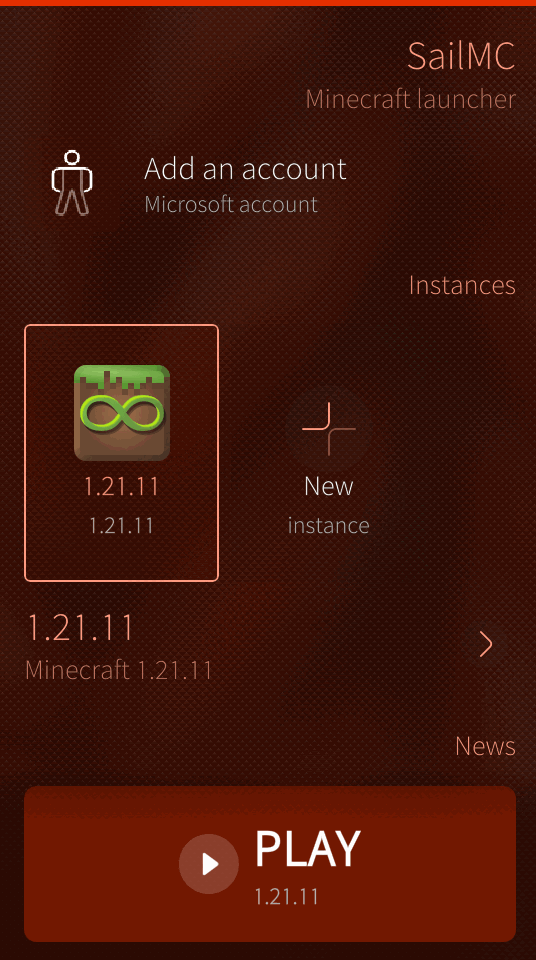
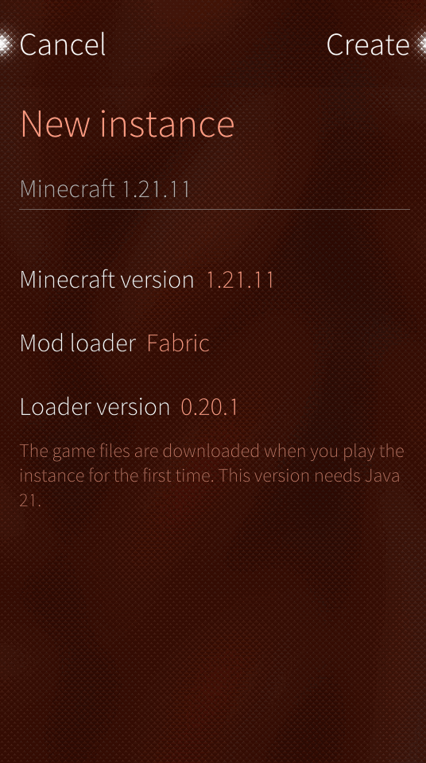
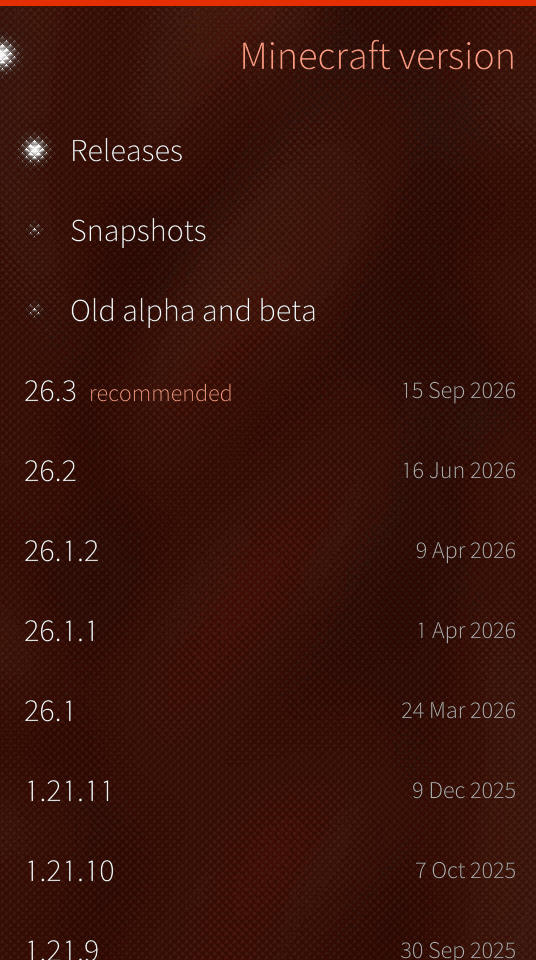
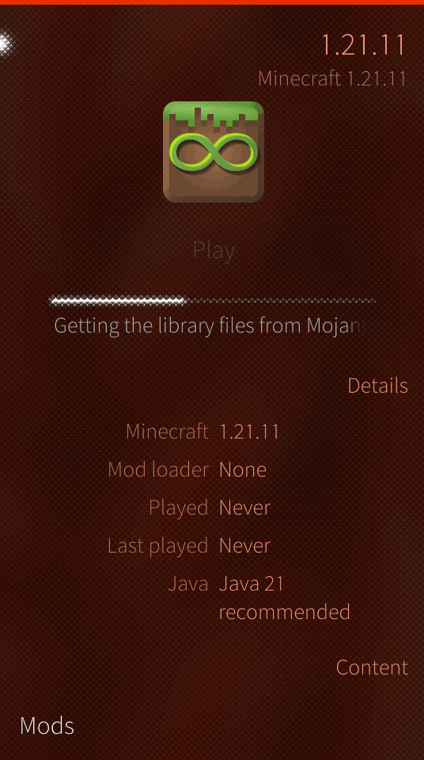
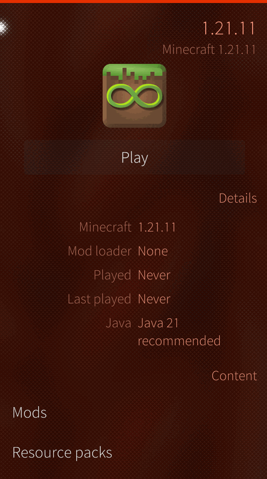
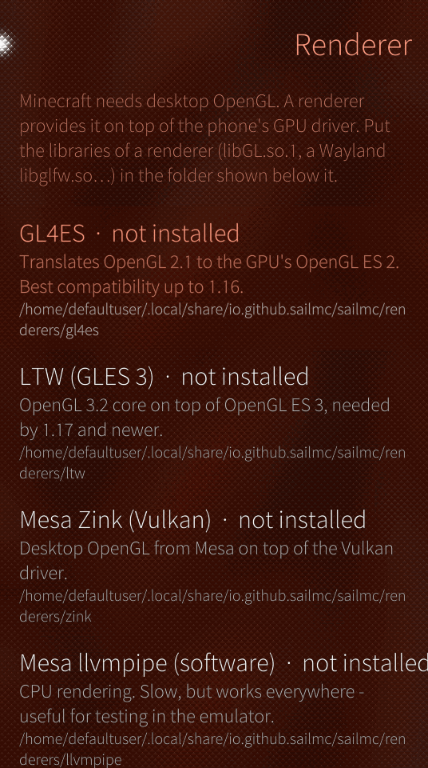
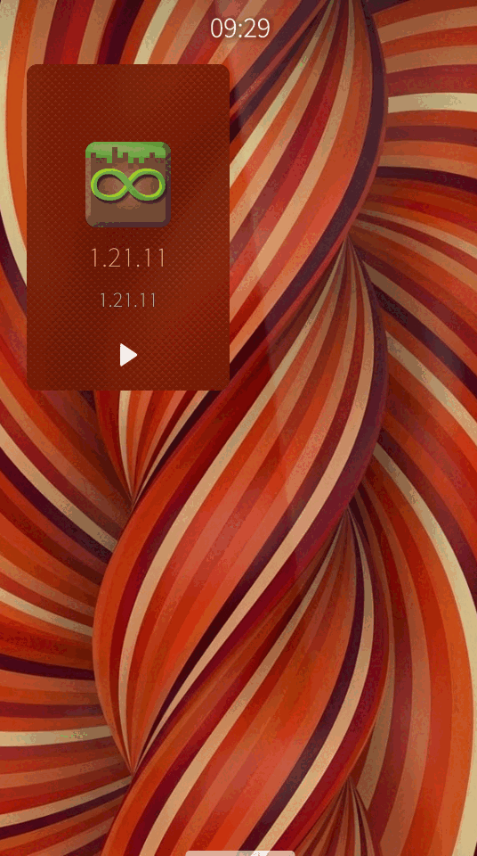

# SailMC – MultiMC for Sailfish OS

SailMC is a native Sailfish OS fork of the MultiMC Minecraft launcher. The launcher core
(`launcher/` without `launcher/ui/`) is unchanged MultiMC code; the QtWidgets interface is replaced
by a Silica/QML one whose layout follows MojoLauncher for Android: account at the top, a strip of
instances ("profiles"), news, and a large **PLAY** button at the bottom.

Screenshots from the Sailfish OS 5.1 SDK emulator (running in QEMU):

| Home | New instance | Versions | Downloading |
| --- | --- | --- | --- |
|  |  |  |  |
| **Instance** | **Microsoft sign in** | **Renderer** | **Cover** |
|  |  |  |  |

## Features

| Area | What works |
| --- | --- |
| Instances | create (any Minecraft version from the MultiMC meta server, release/snapshot/old filters), Fabric/Quilt/Forge/NeoForge loader selection, rename, icon, delete, notes |
| Game files | download/update through the MultiMC update tasks with progress on the play button and cover |
| Accounts | Microsoft device-code login with QR code, default account, refresh, remove, skin face as avatar |
| Launching | the MultiMC launch pipeline (Java check, natives, `NewLaunch.jar`), offline/demo mode, join-server on launch, live game log |
| Java | detection of runtimes, one-tap download of Eclipse Temurin JRE 8/17/21/25 for aarch64/armv7/x86_64, automatic choice per Minecraft version |
| Rendering | renderer profiles (GL4ES, LTW, Zink, llvmpipe, system) that set `LD_LIBRARY_PATH` and the GL environment of the game process |
| Mods | list, enable/disable, delete mods and resource packs of an instance |
| Sailfish | Silica pages, pulley menus, cover with play/stop action, single running instance, Sailjail metadata |

## How it is put together

```
CMakeLists.txt            -DLauncher_SAILFISH=ON: no QtWidgets, SailMC branding, "sailfish" install layout
launcher/Application.h    includes sailfish/src/core/SailApplication.h on Sailfish
launcher/CMakeLists.txt   builds the UI independent core (Launcher_logic) only
sailfish/src/core/        Application on top of QGuiApplication (settings, network, caches, instances, accounts)
sailfish/src/             QML bridge (SailLauncher), models, Java runtime manager, renderer configuration
sailfish/qml/             Silica pages
rpm/sailmc.spec           package for the Sailfish SDK (mb2 / sfdk)
```

`SailLauncher` takes over the jobs of `MainWindow`, `LaunchController` and `AccountsDialog` of the
desktop launcher. Wherever those show a modal dialog, it emits a signal that the QML turns into a page.

## Building

1. Build the two helper jars on the host (needs a JDK, the SDK build engine has none):

   ```sh
   sailfish/build-jars.sh
   ```

2. Build the RPM with the Sailfish SDK (Qt Creator: open `rpm/sailmc.spec` / the project, or on the
   command line):

   ```sh
   # inside the build engine, in the project folder
   mb2 -t SailfishOS-5.1.0.11-aarch64 build
   ```

   The package targets Sailfish OS 5.x (Qt 5.6). It was built with Sailfish SDK 3.13.5 for the
   `SailfishOS-5.1.0.11-aarch64` and `-i486` targets, the newest the SDK ships; the same spec is
   meant for 5.3 targets once the SDK provides them.

The SDK build engine can run in Docker; without the IDE the engine image from the SDK repository
(`org.merproject.mersdkdocker`) is enough: import it with `docker import`, then create the tooling
and targets with `sdk-assistant` inside the container.

## Testing in QEMU

The SDK emulator image (`Sailfish_OS-5.1.0.11-Sailfish_SDK_Emulator.7z`) is made for VirtualBox.
To use it with QEMU, e.g. on machines without VirtualBox/KVM:

* boot it with a 32-bit x86 kernel that has `DRM_BOCHS`, `VIRTIO_*` and `VIRTIO_INPUT` built in
  (the stock kernel only knows VirtualBox graphics) and pass `root=/dev/vda1`;
* use `-device VGA,edid=on,xres=540,yres=960 -device virtio-multitouch-pci` for display and touch;
* mask the `vboxsf` mounts (`etc-ssh-authorized_keys.mount`, `etc-mersdk-share.mount`, ...) and put
  your SSH key into `/etc/ssh/authorized_keys/<user>/authorized_keys`.

Touch events can then be sent with QMP `input-send-event` (`mtt` events: `begin` with a new
tracking id, `data` for x/y, `end` with tracking id -1, plus a `touch` button event).

## Known limitations

* **Rendering libraries are not bundled.** Minecraft needs desktop OpenGL; on a phone it has to be
  provided by GL4ES/LTW/Zink built for Sailfish OS, plus a Wayland-enabled `libglfw.so` (Mojang ships no
  Linux ARM natives). Put them into `~/.local/share/io.github.sailmc/sailmc/renderers/<renderer>/`
  (or `.../renderers/common/` for shared ones) and enable "Use system GLFW".
* Java has to come from the runtime manager (or `/opt`, `/usr/lib/jvm`); Adoptium has no 32-bit x86
  builds, so the i486 emulator cannot download one.
* Playing needs a Microsoft account that owns Minecraft, as in MultiMC; accounts without the game get the demo.
* Modpack platforms (Modrinth/ATLauncher/Technic import pages) and the skin editor have no QML pages yet,
  their core code is built in.
